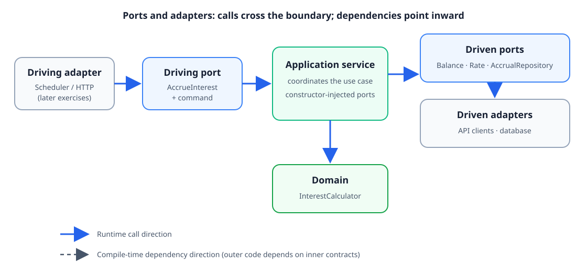

# Exercise 2 — Accrue-interest use case

Exercise 2 connected the domain from Exercise 1 to the outside world through
ports. The application service accepts a request to accrue interest for an
account, currency, and date; it fetches the inputs, delegates the calculation
to the domain, and saves the result.

## What we learned

### Separate driving and driven ports

`AccrueInterest` is a **driving port**: it exposes an application capability
to callers. `AccrueInterestCommand` carries the account, currency, and date for
that request. A future scheduler or HTTP adapter can call this same port.

`BalanceProvider`, `InterestRateProvider`, and `AccrualRepository` are
**driven ports**: they describe capabilities the application needs from its
environment. The application owns these interfaces; API clients and storage
implementations can be added later without changing the use case.

The names are conventions, not mandatory hexagonal-architecture vocabulary.
“Provider” communicates that the application requests information without
committing to where it comes from. “Repository” is a domain-facing abstraction
for storing and retrieving data; it need not imply a particular database or
even durable storage. In this exercise the test implementation is an
in-memory recording fake. `AccrualStore` would also be a reasonable name if
the port remains write-only.

### Coordinate the use case in an application service

`AccrueInterestService` receives its ports in its constructor. Its `accrue`
method uses the command to fetch the balance and rate, then calls
`InterestCalculator` and stores the result. This keeps the application service
focused on orchestration and leaves the calculation rule in the domain.

Calling `InterestCalculator` directly is appropriate here: it is pure domain
logic with no external dependencies. The service does not need to wrap it in
another port just to make the dependency indirect.

The explicit null check on the command makes the use-case boundary reject
invalid input immediately, with a clear `NullPointerException` message.

### Use fakes to test application behavior

The service test uses hand-written recording fakes rather than a mocking
library. It checks that the request values reach the correct ports and that
the expected daily amount is saved. These fakes are also small **test
adapters**: they implement the driven ports while keeping the test independent
of a database or remote service.

### Enforce the dependency rule

The ArchUnit checks make the intended direction executable: domain code must
not depend on application or adapter packages, and application code must not
depend on adapter packages. The test protects future adapters as the project
grows. **Adapters** are concrete edge components: driving adapters call a
use-case port, while driven adapters implement a port the application needs.

In the diagram, blue arrows show runtime calls. Dashed arrows represent
compile-time dependencies: outer code depends on the inner contracts, never
the other way around. In particular, the application calls a driven port at
runtime, but depends only on its interface—not on the API or database adapter
that implements it.

## Discussions and decisions

- The package split `port.in` / `port.out` describes direction from the
  application’s perspective. Other projects may call these driving/driven or
  inbound/outbound ports.
- A command is the input data for an intended action; it is not a database
  command. Putting account, currency, and date together makes the use-case
  request explicit.
- The phrase “provider” does not prescribe an implementation. The port is an
  application-owned contract; a remote client or an in-memory fake can fulfill
  it.
- The direct call to the pure `InterestCalculator` initially felt unusual,
  but we concluded it was appropriate: the application coordinates the flow,
  and the domain owns the calculation.
- The constructor-injection and command-passing pattern felt familiar from
  Spring. This exercise made the underlying concepts explicit rather than
  relying on framework conventions.
- The first implementation omitted an explicit null-command boundary check.
  A focused test specified the desired message; adding
  `Objects.requireNonNull(command, "command")` made the boundary deliberate.

## Test checkpoints

- The initial service test was red against the unimplemented scaffold, then
  passed after the service was implemented.
- The two dependency architecture rules passed once introduced.
- The null-command assertion was red until the explicit boundary check was
  added.
- Final result: **30 tests passed**, and `./gradlew build` succeeded.

## Further reading

- Alistair Cockburn, [Hexagonal Architecture (Ports and Adapters)](https://alistair.cockburn.us/hexagonal-architecture/), the original article.
- [ArchUnit User Guide](https://www.archunit.org/userguide/html/000_Index.html), the official guide to importing Java classes and asserting architectural constraints. The project uses ArchUnit 1.4.1; the online guide may describe a newer release.
- Martin Fowler, [Mocks Aren't Stubs](https://martinfowler.com/articles/mocksArentStubs.html), on the roles of test doubles.

## Remo's strip

|  |  |  |
|---|---|---|
| **Built it:** ports and a service that connected the domain calculation to balance, rate, and accrual fakes | **Broke it:** the scaffold was unfinished, and the use-case boundary initially lacked an explicit null-command check | **Fixed it:** the service coordinated the ports, the boundary rejected null clearly, and ArchUnit guarded inward dependencies |
